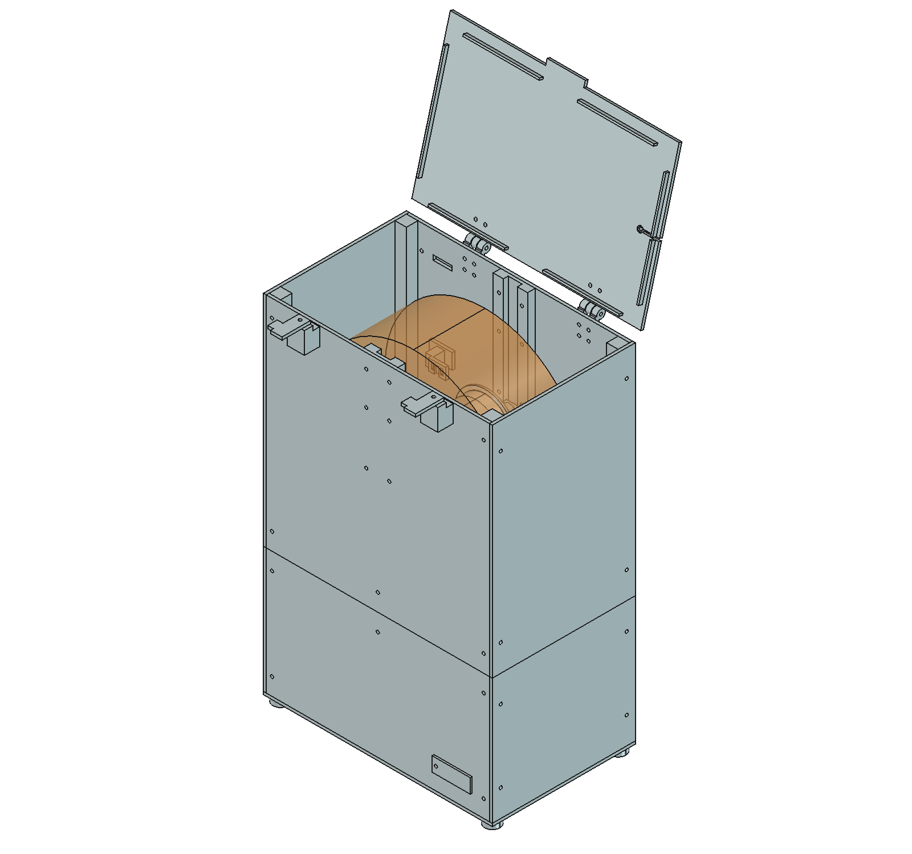
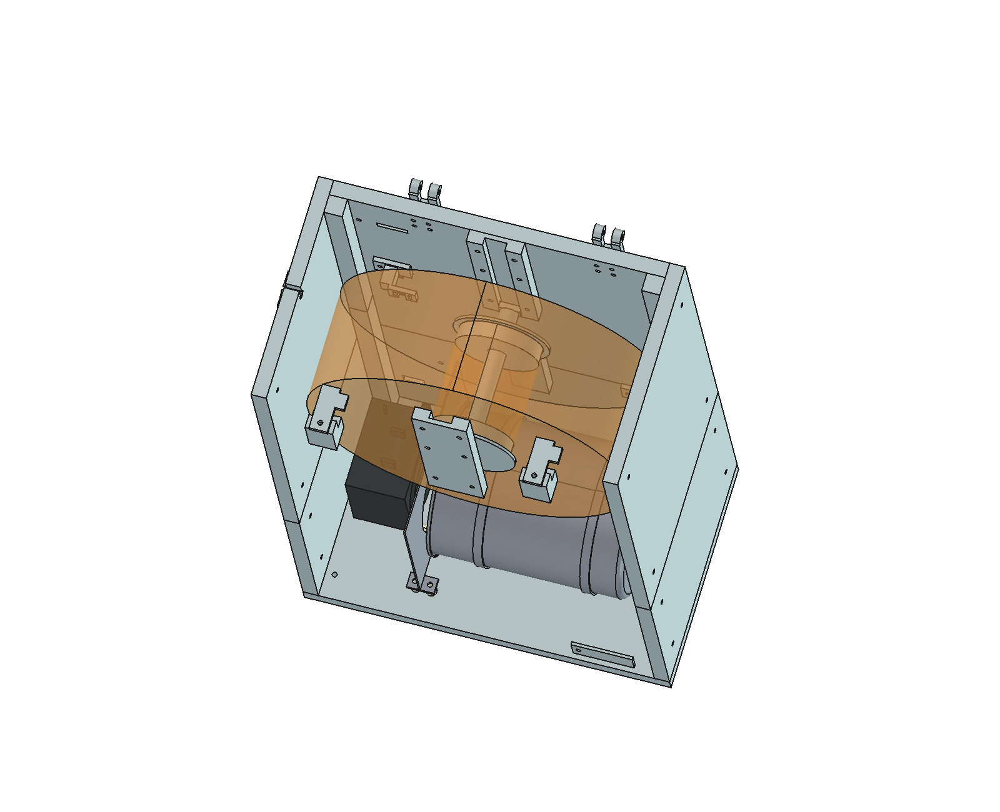

# MYMS

Single-spool filament dryer / feed box, designed in FreeCAD 1.1.4 for printed ABS panels and the owner's 24 V PTC and stainless cup.

For future agents and project context, start with [AGENTS.md](AGENTS.md) and the short [current project handover](docs/PROJECT_STATE.md). Load the linked topic documents as needed; the original planning handover is retained as a marked historical snapshot.

**Current release: mechanical review prototype.** The enclosure, spool mechanism, vent controls, filament guide, and electronics pod have native editable sketch/pad/pocket trees and individual STL exports. The separate heater/cup retrofit adds **four printed supports** around purchased heat-resistant interfaces and stock fasteners. Interface sourcing, actual fit and thermal performance remain unresolved. Do not energize this assembly until those are resolved and the independent cutoff is fitted and tested.

The owner has now printed all `Printed_Assembly` parts. A separate [mounting retrofit](docs/MOUNTING_RETROFIT.md) preserves them and provides four integrated printed supports around purchased PEEK spacers, avoiding fabricated metal bands/partition. Open [MYMS_Mounting_Retrofit.FCStd](cad/assembly/MYMS_Mounting_Retrofit.FCStd) to review it. Geometry checks pass; hardware procurement, cold fit and thermal/airflow validation remain outstanding.



The lid opens on two rear hinges after turning the two front catches by hand. The split, flared filament guide is on the upper left wall; spool bushings remain unchanged. M3 clearance holes are 3.2 mm and heat-set insert pockets are 4.0 mm. The printed-assembly fastener BOM and its assumptions are in [BUILD_GUIDE.md](docs/BUILD_GUIDE.md#printed-assembly-fastener-bom--2026-11-22); heater/cup hardware remains unselected.

The owner's normal print workflow is to export selected FreeCAD bodies together as one 3MF and arrange them in Bambu Studio. Individual STLs are optional convenience outputs with suggested print orientations; the native CAD retains assembly placements. No automatic 3MF export or configured Bambu print project is included.



- Open [cad/assembly/MYMS_Prototype.FCStd](cad/assembly/MYMS_Prototype.FCStd).
- Original hardware models: [Hardware_References.FCStd](cad/assembly/Hardware_References.FCStd), relocated from the former root `myms.FCStd` without changing the CAD contents.
- [exports/prototype](exports/prototype) contains one STL per printed component, an assembled STEP, and `validation.json`.
- [docs/BUILD_GUIDE.md](docs/BUILD_GUIDE.md) covers assembly, print orientation, fit testing, and outstanding hardware.
- [docs/SENSORS_AND_WIRING.md](docs/SENSORS_AND_WIRING.md) shows sensor bodies, retaining ties and wires on the actual mount geometry, and explains the current cable openings.
- [cad/parameters.json](cad/parameters.json) controls regeneration. Sketch dimensions are fixed locally with editable block constraints. Changing the spreadsheet alone does **not** rebuild the design; edit JSON and regenerate.

```bash
bash scripts/build.sh             # geometry, STL, STEP, validation
bash scripts/build.sh --render    # also update FreeCAD opening view and PNGs
```

The runner uses `/home/heits/tools/freecad`; set `MYMS_FREECAD_APPIMAGE` for another FreeCAD AppImage. It mounts the image temporarily and uses its bundled Python, without installing packages. Rendering needs a working graphical display. Generated geometry and export validation runs without the GUI.

The chamber has 10 mm side panels, base and lid, with a 240 × 150 mm exterior footprint. The interior is 220 × 130 mm in plan before the mounts. The closed hinges and catches reach Z=378.5 and the feet reach Z=-13. The rear electronics pod extends to Y=199 and front hardware to Y≈-16.5. Allow additional clearance above and behind the box to open the lid. Every printed part fits a 240 × 240 mm envelope in its supplied orientation. STL coordinates are oriented for printing and translated onto Z=0; STEP and FCStd retain assembly positions. A 246 mm envelope check leaves nominal space inside the P1S's 256 mm build volume; brim and excluded-bed regions must still be checked in the slicer. [Bambu P1S specifications](https://store.bblcdn.com/s5/default/78c105c0c92642a99e64b4b0b0f3ca6a.pdf).

The [ESP32-C3 firmware](firmware) now includes a PlatformIO/VS Code workspace, local live admin, hysteresis control, device CSV sessions and a computer recorder. Open [myms.code-workspace](myms.code-workspace) and follow the [firmware guide](docs/FIRMWARE.md). Start with the simulation or default monitoring build: nothing is wired yet, and physical outputs are disabled in both. The software compiles but has not been uploaded or physically tested; no complete electrical design, thermal certification or measured drying performance is included.

Shell dimensions describe the current layout; some mounting coordinates depend on this layout and need review when resizing the shell. Spool size, bore, journal clearance, and exit diameter are the intended fit adjustments. The build validates geometry after regeneration.

The [electrical schematic and passive-component guide](docs/ELECTRICAL_SCHEMATIC.md) covers the existing LM2596, 24 V heater/fan, two MOSFET modules, sensor pull-up/decoupling and a proposed 5 V trigger buffer. It distinguishes required parts from optional capacitors and unverified module/fuse details; it is not a tested electrical build.
