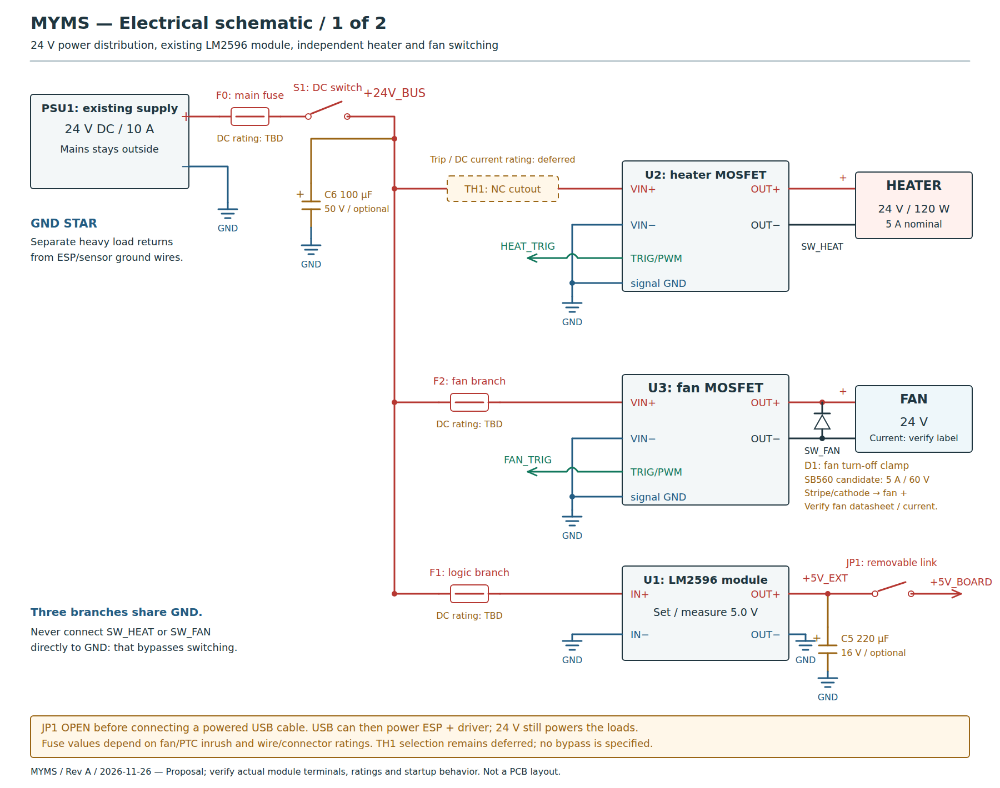
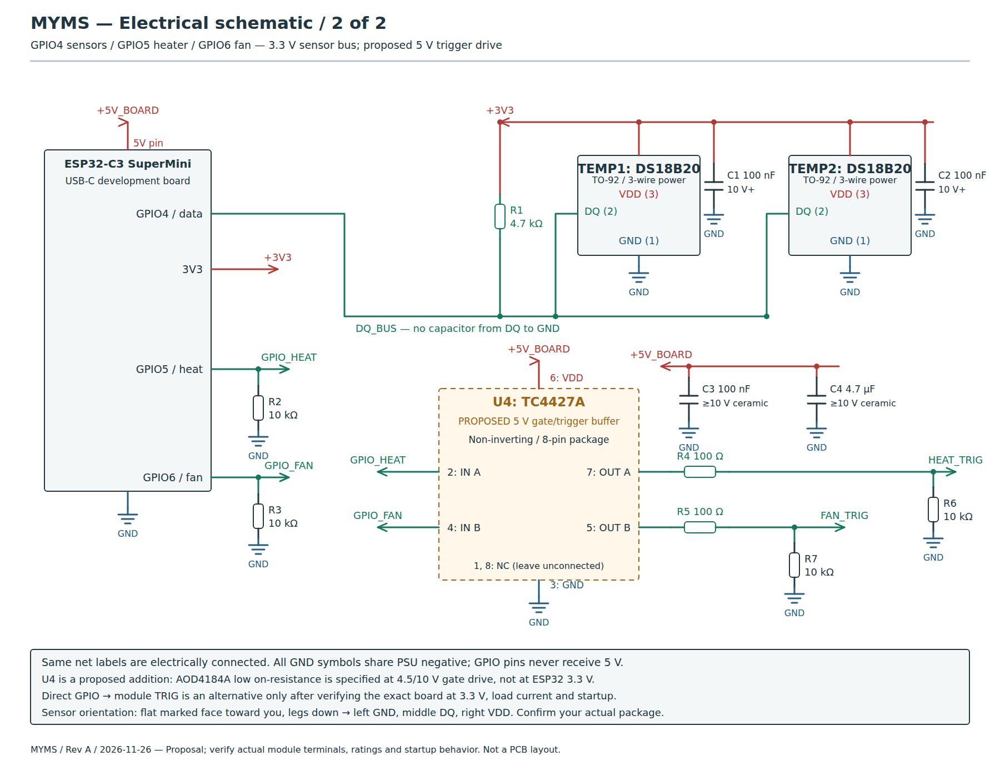

# Electrical schematic — revision A, 2026-11-26

Module-level wiring proposal for the purchased ESP32-C3 SuperMini, LM2596 converter, 24 V / 120 W PTC element, separate 24 V fan and D4184-type switching modules. **Owner-confirmed this turn:** the fan is also 24 V; each MOSFET module has one `TRIG/PWM` input and signal `GND`. The exact board photo/model, power-terminal mapping and fan current were not supplied. This is a connection design, not a verified electrical build, PCB layout or permission to energize the unfinished heater assembly.

## Drawings and editable data

- [Sheet 1: 24 V power, LM2596 and loads — PNG](electrical/01-power.png) / [vector SVG](electrical/01-power.svg).
- [Sheet 2: ESP32, sensors and proposed trigger buffer — PNG](electrical/02-control-and-sensors.png) / [vector SVG](electrical/02-control-and-sensors.svg).
- [Connection list and component status](electrical/connections.json): machine-readable wire/net list, not a KiCad PCB netlist.
- [SVG generator](../scripts/draw_electrical_schematic.py) and [consistency checks](../scripts/check_electrical_schematic.py).





Names repeated on different sheets are the same electrical net. Dots indicate connections. Component drawing positions are schematic symbols, **not the physical order of terminals on your modules**. Ground is the low-voltage supply negative, not an instruction to connect to protective earth or mains. All project documentation remains in English.

## What is actually required versus optional

The main **required extra resistor for sensor communication is R1, one 4.7 kΩ pull-up shared by both sensors**. The ESP32 firmware does not enable an internal pull-up. The 100 nF capacitors at the sensors are recommended supply decoupling, rather than a requirement for every short-wire bench test. The DS18B20 datasheet supplies the three-wire pinout, common 1-Wire bus architecture and external pull-up requirement. [Analog Devices DS18B20 datasheet](https://www.analog.com/media/en/technical-documentation/data-sheets/DS18B20.pdf)

Your **LM2596 is a complete converter module**, not a bare regulator IC. Its inductor, catch diode, adjustment network and input/output capacitors are already part of the module. Do not build a second copy of the IC application circuit or replace the existing capacitors by guesswork. The regulator's external-component requirements, including capacitor ESR, apply to the module's design; optional wiring reservoirs are a different matter. [TI LM2596 datasheet](https://www.ti.com/lit/ds/symlink/lm2596.pdf)

| Reference | Quantity / value | Classification and location |
| --- | --- | --- |
| R1 | 1 × **4.7 kΩ**, ¼ W, 5% adequate | Required: GPIO4/DQ bus to **3V3**, one shared resistor |
| C1, C2 | 2 × **100 nF ceramic**, ≥10 V; 50 V parts are fine | Recommended: each sensor VDD to GND, physically beside that sensor |
| R2, R3 | 2 × **10 kΩ**, ¼ W | Required default-low input bias if U4 is installed; useful on direct-drive GPIOs too |
| U4 | 1 × **TC4427A**, non-inverting dual driver, 8-pin PDIP convenient | Proposed addition for a D4184 board whose gate receives approximately the trigger voltage; see below |
| C3 | 1 × **100 nF ceramic**, ≥10 V | Required local supply bypass for U4 if installed |
| C4 | 1 × **4.7 µF**, ≥10 V, ceramic preferred | Local reservoir for U4; fit beside U4 with C3 |
| R4, R5 | 2 × **100 Ω**, ¼ W | Proposed U4 output series resistors; may be redundant with a module's own gate resistor |
| R6, R7 | 2 × **10 kΩ**, ¼ W | Recommended module-input default-low bias; omit only if an adequate internal pull-down is identified |
| C5 | 1 × **220 µF / 16 V electrolytic** | Optional external-5 V reservoir, **before JP1**; not a mandatory replacement for converter capacitors |
| C6 | 1 × **100 µF / 50 V electrolytic** | Optional local 24 V bus reservoir; not mandatory if installed decoupling and wiring are adequate |
| D1 | **SB560**, 5 A / 60 V Schottky, candidate | Fan turn-off clamp provision, subject to fan current/transient specs and existing suppression |
| JP1 | Removable link/jumper | Isolates external buck +5 V when USB powers the controller |
| F0, F1, F2 | DC-rated fuses/holders; current values **TBD** | Main input, logic branch and fan branch respectively |
| TH1 | Independent normally closed heater cutout; exact device **deferred** | Series heater-positive interruption; not in the fan/logic branches |

For the complete buffered proposal, the resistor count is **1 × 4.7 kΩ, 4 × 10 kΩ and 2 × 100 Ω**. The drawn buffered version includes **3 × 100 nF plus 1 × 4.7 µF**: two sensor capacitors are recommended, and the other two capacitors apply only if the driver is installed. C5/C6 are optional diagnostic additions, not a demand to purchase large capacitors before trying sensors.

No capacitor belongs between **DQ and GND** in this design: that would load the data waveform. All capacitors shown are across supply and ground. Electrolytics are polarized; the `+` marking goes to the relevant positive rail. Resistor orientation does not matter. Capacitor voltage ratings are maximum working limits; choosing a higher voltage rating does not apply that voltage to the ESP32 or sensors.

## 24 V power and load paths

1. External 24 V PSU positive → F0 → S1 → `+24V_BUS`. Route high-current heater wiring directly through suitable terminals, not a solderless breadboard, ESP32 pins or Dupont leads. PSU negative forms the common return point.
2. Heater branch: `+24V_BUS` → TH1 → heater module VIN+; module OUT+ → heater positive; heater negative → module OUT−. VIN− and signal GND go to the common ground. **Never ground the heater's switched OUT−**, which would bypass the switch.
3. Fan branch: `+24V_BUS` → F2 → a **second independently controlled module** VIN+; module OUT+ → fan positive; fan negative → module OUT−. Its VIN− and signal GND go to common ground. The fan is owner-confirmed 24 V; its current/polarity still need label verification.
4. Logic branch: `+24V_BUS` → F1 → **LM2596 IN+**, with IN− to ground. Adjust and measure **5.0 V** before connecting its OUT+ through JP1 to the board's **5V** input. OUT− shares ground. Do not feed 24 V to the ESP32, and do not feed the buck's 5 V output to its **3V3** pin.

The power-module drawing assumes the common low-side arrangement: VIN+/OUT+ are internally common and VIN−/signal GND are common; OUT− is the switched node. The owner's signal-label confirmation alone does **not** establish these power-terminal connections. Confirm labels and board topology before applying these wire assignments. No advertised "15 A / 400 W" value is treated as a verified continuous rating.

A board with one TRIG input is one control channel even if it contains two MOSFETs. The firmware needs separate heater and fan channels for pre-run and cooldown. Use two such modules; a "dual MOSFET" description does not establish two independent channels.

The heater's nominal calculation is 120 W / 24 V = **5 A**, not a measured cold-start current. F0 must protect the actual high-current wiring/connector; F1/F2 protect thinner branch wiring. Final fuse ratings need PTC inrush, fan startup/current and component/wire/connector limits. A 10 A supply label is not a reason to install 10 A fuses everywhere. TH1's exact trip, installation and **DC interrupt rating** remain deferred; its location is shown without specifying a bypass. Only the heater branch is interrupted so fan/control can retain power after a heater overtemperature trip.

## Sensor connections

Both DS18B20 TO-92 sensors share:

| Sensor pin | Connection |
| --- | --- |
| 1 — GND | ESP/common GND |
| 2 — DQ | GPIO4 / `DQ_BUS` |
| 3 — VDD | ESP **3V3** |

For the standard bare TO-92 package, flat marked face toward you and legs down gives GND, DQ, VDD from left to right. Verify the actual part; this is not a wire-color instruction for packaged probes. Use three-wire powered mode. One R1 connects the shared DQ line to 3V3; C1/C2 each connect VDD to GND at the sensor, keeping their leads short. Keep sensor wiring separate from heater/fan current loops, with data and a ground return routed together.

Restart the controller after attaching/replacing sensors; discovery currently happens at boot. Assign the two distinct sensor ROMs in the admin. Serial air/wall `NaN` can indicate unassigned roles, not only an electrical fault. The owner's earlier sensor attempt had no external pull-up and yielded NaN logs; no valid measured-temperature result has been reported.

## Why a proposed 5 V trigger buffer is shown

The ESP32 has 3.3 V GPIOs. For an **AOD4184A**, low on-resistance is specified at 4.5 V and 10 V gate drive; its threshold voltage is not a full-load operating specification. A generic module advertised as accepting a 3.3 V trigger may turn on without having its 5 A heater loss/temperature established. Some boards have their own gate driver and others couple TRIG to the gate through a resistor. We have not identified the exact board circuit. [AOS manufacturer datasheet](https://www.aosmd.com/pdfs/datasheet/AOD4184A.pdf)

U4 is a **proposed additional component**, not hardware the owner is assumed to own. Its role is to accept the ESP32's 3.3 V command and supply a 5 V trigger from the same regulated board supply. TC4427A is non-inverting and accepts a logic high from 2.4 V; it operates from 4.5–18 V. For the 8-pin PDIP/SOIC/MSOP package used in the drawing: pins 2/4 are inputs, 7/5 outputs, 6 supply, 3 ground; leave 1/8 unconnected. Local supply bypass is essential. [Microchip TC4427A datasheet](https://ww1.microchip.com/downloads/aemDocuments/documents/APID/ProductDocuments/DataSheets/TC4426A-TC4427A-TC4428A-1.5A-Dual-High-Speed-Power-MOSFET-Drivers-20001423.pdf)

U4 and both MOSFET signal grounds share ESP ground. R2/R3 bias its inputs LOW while GPIOs are high impedance. R6/R7 bias the module inputs LOW if the signal source is disconnected/unpowered, subject to the module's actual circuit. R4/R5 limit edge currents/ringing; they are not load-current resistors and do not go in heater/fan power wires. The modules often already contain gate resistors/pull-downs; inspect those before duplicating or changing their values.

**Direct-drive alternative:** if the exact module is documented and verified to switch the required current acceptably with 3.3 V, GPIO5 can drive heater TRIG and GPIO6 fan TRIG without U4. Keep the appropriate default-low bias, remove the driver-only C3/C4 and connect the GPIO signals to the corresponding module inputs; series resistors may be omitted if already provided on the module. Never connect a 5 V driver output to an ESP GPIO. U4 also assumes a module input that tolerates 5 V; check that specification rather than adding it blindly to an unidentified logic board.

R2/R3 and R6/R7 are bias measures, not proof that every startup/brownout/power-order condition is glitch-free. Verify both modules' OFF state with the actual board during boot, reset, missing-USB and missing-control-power conditions before enabling a heater. Driver and module losses, cooling, rated current and reset behavior require physical validation. Firmware `monitor`/`simulation` continue to disable physical outputs; `dryer` uses GPIO5/6 active HIGH. The proposed non-inverting buffer preserves that polarity.

## Capacitors and supply behavior

The ESP32 board is a development board with an expected onboard 3.3 V regulator and its local bypass components; a bare ESP32 chip reference schematic is not a list of all the components to add externally. Espressif calls for a supply capable of supporting radio current peaks; its chip guidance recommends at least 500 mA at 3.3 V. Give the complete board a stable 5 V supply with sufficient headroom (a **5 V / 1 A-capable path** is a reasonable design target, not a measured project load). Keep power wires short. The LM2596 module's practical capability still depends on its inductor, diode, capacitors and cooling. [Espressif C3 supply guidance](https://docs.espressif.com/projects/esp-hardware-design-guidelines/en/latest/esp32c3/schematic-checklist.html)

C5 is an **optional** 220 µF reservoir near the buck/JP1 when long 5 V leads or radio-induced dips justify it. It is placed on **+5V_EXT before JP1**, so opening the jumper also disconnects that large capacitance from USB power. Do not attach a large reservoir indiscriminately to USB VBUS or assume capacitors cure undersized wire, inadequate regulators or ground bounce. Check the converter's existing output capacitance/stability and actual rail behavior first. C6 is an optional input-side 100 µF / 50 V electrolytic for local 24 V wiring; the module likely already has input capacitance. Neither is required for a USB-only sensor test.

D1 is drawn across the fan supply terminals, **stripe/cathode to fan positive, anode to switched fan negative**. It is reverse-biased during normal operation. SB560 is a proposed 5 A / 60 V Schottky example, not a final selection without the fan current/inrush, temperature and transient data. A brushless fan has internal electronics; confirm manufacturer suppression recommendations and any protection already on the module. The MOSFET body diode alone is not the same as a diode across the fan load. The resistive PTC element does not need a motor-style flyback diode. [Diodes Incorporated SB560 data](https://www.diodes.com/part/view/SB560)

## USB and common-ground arrangement

**Open/remove JP1 before plugging in a powered USB cable.** Then USB powers the ESP and U4 while the 24 V PSU powers the heater/fan branches; the buck output is isolated from the board's 5 V rail. Keep all required low-voltage grounds connected. For standalone operation, unplug USB and fit JP1 to power the controller from the measured 5.0 V buck output. The exact SuperMini's USB power isolation is not verified, so this design does not rely on an assumed onboard OR-ing diode. JP1 is the external power feed link, not a link in GPIO/data/ground.

Connect heavy heater/fan return wires directly to the supply return distribution. Connect ESP/buck/signal returns by their own branch. This keeps high current out of the ESP, USB connector and sensor-ground wiring. The externally enclosed PSU's mains wiring stays outside the project.

## Checks and unresolved selections

Generate SVGs with `python3 scripts/draw_electrical_schematic.py`; run `python3 scripts/check_electrical_schematic.py` to check firmware pin agreement, unique pin/net assignments, switched returns, diode polarity, jumper placement and XML syntax. These checks are not an electrical rules check on a PCB, a circuit simulation, an oscilloscope test or physical validation. PNGs are rendered previews of the SVG sheets. To regenerate and check text bounds with local Chrome:

```bash
npm install --prefix /tmp/myms-electrical-tools playwright-core@1.56.1 --no-audit --no-fund
NODE_PATH=/tmp/myms-electrical-tools/node_modules node scripts/render_electrical_schematic.cjs
```

Set `CHROME_PATH` if Chrome/Chromium is elsewhere. The SVG generator and net checks require only Python's standard library; browser packages are optional preview tooling.

Before converting this proposal into a final build, identify the exact MOSFET power terminals and trigger circuit, fan current/polarity/startup behavior, actual PTC inrush, buck output and installed capacitors, SuperMini power topology and appropriately rated fuses/connectors. TH1 selection stays explicitly deferred. No CAD, firmware pin allocation or protection selection is silently changed by this schematic.
