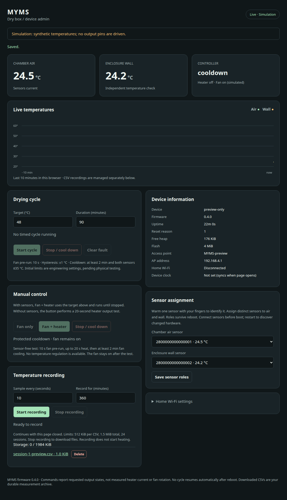

# ESP32-C3 firmware and measurements

Implemented 2026-11-24 as a first software prototype. The owner confirmed **nothing is wired yet** and chose **device CSV sessions plus a computer recorder**. All three environments compile; controller and recorder tests run on the computer. No agent-performed upload, GPIO verification or thermal validation has been performed. The owner later attempted a sensor test without the external pull-up and reported NaN serial values; no successful readings or heating results are confirmed. See [ELECTRICAL_SCHEMATIC.md](ELECTRICAL_SCHEMATIC.md) for the subsequent wiring/passive-component proposal. CAD is unchanged.



## Open and run in VS Code

1. Open [`myms.code-workspace`](../myms.code-workspace) using **File → Open Workspace from File**. Install the recommended **PlatformIO IDE** extension. The firmware folder is the PlatformIO project; the second workspace folder gives access to CAD and documentation.
2. In PlatformIO's **Project Tasks**, select an environment, then **General → Build**. Start with `simulation` for a USB-only demonstration or `monitor` for real sensors without driven power outputs. PlatformIO downloads the pinned platform and libraries.
3. Connect the ESP32-C3 with a USB **data** cable. Choose **Upload**, then **Monitor** (115200 baud). After upload the USB port may reconnect under a different name. If automatic upload fails, hold BOOT, tap RESET, release BOOT, then retry; board-specific behavior still needs checking.
4. Join the `MYMS-<device suffix>` Wi-Fi network with password **`myms1234`**. Open **http://192.168.4.1** directly; the admin page has **no login**. The serial banner shows connection details; type `info` and Enter to repeat them.
5. In the admin, initialize recording storage on the first run. This is explicit because automatically formatting an unmountable filesystem could erase test results. For a damaged existing filesystem, download/recover anything possible before choosing initialization.
6. Optionally join home Wi-Fi through the admin. The device AP remains available; its information panel gives the home-network IP. Use that address from a computer on the same network.

At the owner's request, the **admin page and API have no authentication** as of firmware 0.4.0. The device Wi-Fi still uses **`myms1234`**, configured by `AP_PASSWORD` in `firmware/src/main.cpp`; removing the admin login did not make the AP open. Old `admin_key` NVS entries are ignored, with no flash erase needed. Saved home Wi-Fi settings, sensor roles and recordings are preserved. Anyone who can reach the device on its AP or home network can read telemetry, operate outputs and manage settings/files. Use the local network without internet port forwarding. Home Wi-Fi credentials travel over local HTTP and are stored in device flash without flash encryption. The serial banner and `info` command print the Wi-Fi password and indicate that admin needs no login.

Equivalent commands from the repository root, in a PlatformIO terminal:

```bash
pio run -d firmware -e monitor
pio run -d firmware -e simulation -t upload
pio device monitor -b 115200
# When needed: add --upload-port /dev/ttyACM0 to upload,
# or --port /dev/ttyACM0 to device monitor; actual port varies.
```

Build environments:

| Environment | Sensors | Heater/fan GPIO | Cycle controls |
| --- | --- | --- | --- |
| `monitor` (default) | Real DS18B20 bus | Never configured as outputs | Start rejected; telemetry/recording available |
| `simulation` | Synthetic air/wall temperatures | Never configured as outputs | Simulated heating/cooling; every CSV marks `simulation=1` |
| `dryer` | Real DS18B20 bus | Enabled using reviewed pin/polarity configuration | Full controller, requires fresh assigned sensors |

Build/upload/serial monitor and PlatformIO **Project Inspect** are supported. Breakpoint debugging is not configured or verified on the owner's exact SuperMini; USB/JTAG access, board support and drivers need checking before adding that workflow. Monitor means the build environment for reading real sensors; PlatformIO's serial **Monitor** tool works with every environment.

The pinned platform is `espressif32@6.13.0`, Arduino core 2.0.17, with OneWire 2.3.8, DallasTemperature 3.11.0 and ArduinoJson 6.21.5. The `esp32-c3-devkitm-1` board definition is a **4 MiB flash compatibility assumption**, not identification of the owner's board. Check reported flash capacity before use. The custom partition table has a 2 MiB application and 1.9375 MiB LittleFS partition, with no OTA. The web UI is embedded in the application: **do not upload a filesystem image** to install it. `uploadfs`, full-flash erase, or changing the partition layout can destroy recordings. Normal application uploads with the same partitions preserve NVS and CSVs.

## Wiring and commissioning

[`hardware_config.h`](../firmware/include/hardware_config.h) is the single proposed pin/polarity configuration:

| Function | Proposed GPIO | Current assumption |
| --- | --- | --- |
| Shared DS18B20 data bus | GPIO4 | Three-wire powered sensors, 3.3 V bus with external pull-up; typically 4.7 kΩ |
| Heater driver input | GPIO5 | HIGH enables heater; verify actual driver |
| Separate fan driver input | GPIO6 | HIGH enables fan; driver not selected/verified |

These are **not owner-confirmed wiring**. Verify the exact SuperMini labeling, sensor package pinout, driver input compatibility, common-ground requirements, fan voltage and default-off behavior. Do not connect fan/heater loads directly to GPIO. GPIO4–7 also have external JTAG functions. C3 boot strapping pins and the USB GPIO18/19 pair are avoided. Do not change USB pins while relying on USB monitoring. The MCU's reset/boot state occurs before this application runs; external driver biasing must keep the heater off during that interval.

Commission with USB and sensors first, then unloaded driver inputs, before choosing `dryer`. Each sensor is discovered at boot by its CRC-checked DS18B20 ROM; up to eight sensors are displayed. Warm one gently to identify it, assign **air** and **wall** in the admin and save. Distinct addresses are required and survive reboot. Sensor enumeration order never selects roles automatically. Reboot to discover sensors added/replaced since startup. Simulation uses separate synthetic role assignments and does not overwrite real saved roles.

## Control behavior and rationale

- A high-priority FreeRTOS task handles sensor conversion, controller decisions and outputs, independently of HTTP requests, CSV downloads and serial output. Sensor conversions are nonblocking, 12-bit, with roughly one reading per second. The chart polls once per second; it retains ten minutes in the current browser only.
- A cycle begins with **10 seconds of commanded fan operation** before heat. Cycle duration includes this pre-run and starts immediately, not when the target is reached. The heater switches on at target −1 °C and off at target +1 °C; the deadband avoids rapid toggling. There is no PWM/PID or saved material profile.
- Initial selectable targets are **25–55 °C**, default **45 °C**, with cycle durations **1 minute–24 hours**. These are conservative initial engineering settings, not measured operating limits or filament recommendations. Hard software trip thresholds are **65 °C air or wall**; two sensors cannot map all hotspots.
- Missing, disconnected, nonfinite, out-of-range or stale (>3 seconds) assigned sensors stop heating during an active cycle/cooldown. The DS18B20 85 °C startup sentinel is rejected. Overtemperature latches a fault whenever a complete valid sample is available, including while idle.
- Stop/expiry turns heat off and commands fan cooldown for **at least two minutes and until both sensors are ≤35 °C**. A sensor failure during cooldown latches a fault. A fault keeps heat off and, where control is enabled, commands the fan until explicitly cleared with both fresh readings ≤35 °C.
- A reboot always returns the controller to idle with heat/fan commanded off; it never resumes a cycle. A hot valid reading after reboot can trigger the overtemperature fault. Persistent fault history/automatic recovery cooling after every power loss are not implemented. No heating state is restored from NVS.
- HTTP/Wi-Fi disconnection does not stop the local controller. Losing mains power or a frozen MCU cannot be handled by software alone. Output states in UI/CSV are **commands**, not measured current or fan rotation; there is no tachometer or fan-failure feedback hardware.

Independent thermal cutoff selection remains deferred; firmware does not replace it. No energized operation of the unfinished mechanical/electrical prototype has been validated. The documented mounting/protection and supervised thermal-test work remains outstanding; this does not block USB-only development.

## Manual controls — firmware 0.4.0, 2026-11-26

The admin's **Manual control** panel provides **Fan only**, **Fan + heater** and **Stop / cool down**. Regulated manual operation has no cycle timer and continues if the browser closes or Wi-Fi disconnects. Without fresh assigned sensors the heat button instead becomes **Test heater (20 s)**, a bounded output test described below. No mode resumes after an ESP32 reboot.

- **Fan only:** from idle, starts only the fan and permits testing without assigned/valid temperature sensors. Stop turns the fan off immediately in this mode. Valid overtemperature readings still latch a fault; a fault's commanded cooling fan cannot be overridden through manual controls.
- **Fan + heater:** uses the **Target (°C)** field above the panel. Starts from idle or manual fan-only, requires both fresh assigned sensors and a 25–55 °C target, runs a fresh 10-second fan pre-run, then uses the existing ±1 °C heater hysteresis. It is an untimed regulated mode, not a raw GPIO override or forced continuous heater ON.
- **Stopping heat or choosing Fan only during a heating mode:** turns the heater off and enters the same protected cooldown as a timed cycle: at least two minutes and both fresh readings ≤35 °C. Repeated fan/stop requests cannot bypass that cooldown. Once cooldown completes, the controller returns to idle; this transition does not leave an indefinite manual fan session running.
- Invalid/stale sensors during manual heat or its pre-run/cooldown latch a fault, with heat off and fan commanded on. Existing 65 °C air/wall trips and fault reset conditions remain active. Timed drying cannot start on top of manual operation; stop/cool down first.

Use `dryer` to drive the reviewed physical GPIOs, or `simulation` to exercise the controls without driving them. The default `monitor` build still rejects output commands and disables the UI buttons; adding manual controls does not enable hardware outputs in that environment. These modes do not establish actual airflow/heater current or replace the independent protection work.

The status/CSV `state` field distinguishes `manual-fan`, `manual-fan-prerun` and `manual-heat`; manual `remaining_s` is zero. Temperature recording is independent, so it can cover manual start, regulation and cooldown. The serial banner and UI now report firmware 0.4.0.

### Sensor-free heater output test

The owner requested operating the heat button before connecting sensors. Firmware 0.4.0 enables an **explicit 20-second output test**, while continuous/manual regulated heat and timed cycles still require both sensors. The UI sends `mode: "test-heat"` only when sensor readings are unavailable; `mode: "heat"` never silently falls back to sensor-free heating if a sensor fails between status polling and the request.

The test starts from idle or manual fan-only, commands the fan for **10 seconds**, then commands the heater for **at most a nominal 20 seconds**, turning it off at the first control-task iteration at/after expiry (normally ~20 ms iteration spacing). No temperature setpoint is used. Stop or Fan only turns heat off earlier. Active tests and cooldown reject new heat-test requests, so repeated clicks cannot restart or extend the timer.

After the pulse or an early Stop, the fan remains on for at least **two minutes**. If both sensors are fresh, readings must also be ≤35 °C before leaving that phase. Without valid readings the controller cannot establish that hardware is cool, so after the minimum time it enters **manual fan-only**, leaving the fan on until the operator stops it. Fan/stop commands during the minimum cooldown cannot cancel it. A reported overtemperature on an available assigned sensor still blocks/latches a fault, even if the other sensor is missing. Existing faults cannot be bypassed through this test.

This is an output-check mode, **not sensor-free drying or temperature regulation**. The software timer does not establish a safe surface temperature, actual fan rotation, successful MOSFET shutoff or protection if the controller freezes. The unfinished mounting/electrical protection work is not validated by this feature.

The status/CSV states are `heater-test-prerun`, `heater-test`, `heater-test-cooldown`. Status exposes `heater_test_limit_s` and `heater_test_remaining_s` (the current phase countdown); test-mode `target_c` is null, and CSV targets are blank so a regulated temperature is not falsely recorded. Recording remains independent. Default `monitor` still disables every output command; `simulation` drives no GPIOs.

## Recording workflow and storage rationale

The owner selected two complementary recording paths rather than making a web browser the only data store:

**ESP32 sessions:** select sampling interval (1–3600 seconds) and recording duration (up to seven days) in the admin, then Start recording. The first sample is immediate. Recording is independent of heating: start it before a cycle and keep it through cooldown. Closing the page has no effect. Stop recording before downloading CSVs; this avoids download-induced sampling gaps. Recordings stop automatically at duration, file/storage quota, write failure or reboot. The last error is displayed while running; after reboot, existing partial CSV files remain downloadable, but recordings do not resume. There is no automatic file deletion or rotation that could silently discard a test.

Limits are **512 KiB per CSV, 1.5 MiB total filesystem usage and 24 retained sessions**. The first reached limit stops a session and reports the reason. Download and explicitly delete old sessions. At a 10-second interval a six-hour test has 2160 samples and should fit a file at ordinary row sizes; confirm actual usage. A one-second interval fills storage much faster and writes flash more often. Use the computer path for extended tests. Flush follows each row to reduce power-loss exposure; flash is not a durable archive, and the final row/file can still be damaged by power loss.

CSV columns: schema version, device ID, session filename, UTC epoch seconds (blank if unset), monotonic device uptime milliseconds, monotonic session elapsed milliseconds, air/wall °C (blank for invalid values), controller state, target °C, heater/fan commands, fault text and simulation marker. Elapsed time remains meaningful if the wall clock is unset or corrected. The admin synchronizes UTC from your computer/phone when opened; there is no battery RTC or automatic NTP. After reboot it is unset until synchronized. Missing samples are not backfilled or invented. Controller safety checks run independently of recording; slow filesystem/HTTP work can still delay a CSV sample.

**Computer recorder:** connect to the device's AP or use its home-Wi-Fi IP. From the repository root:

```bash
python3 scripts/record_temperatures.py http://192.168.4.1 --interval 10 --duration 21600
```

The recorder connects without an admin password or interactive prompt. It sends no Authorization header and no longer uses `MYMS_PASSWORD`. The computer must stay awake, connected and running the recorder. Ctrl+C closes the CSV cleanly. Disconnections produce timestamped gap/error rows and retry; an HTTP 401/403 rejection stops recording with an error. It never starts heating or device recording.

By default, new files live under repository-root **`measurements/`**, ignored by Git. `--output /absolute/path/test-name.csv` selects another location; existing files are never overwritten. Put downloaded device CSVs there too, then back up completed experiments to your usual durable storage. Do not commit every raw session into the CAD/code repository. Keep a small experiment note beside each CSV with firmware revision, sensor positions, spool/material/mass, ambient conditions and changes under test; conclusions alone can go in tracked documentation. Computer CSVs have their own schema, including computer UTC, device UTC/uptime, live device fields and connection errors.

## API and verification

The page and API require **no username/password**. Mutating requests retain `X-MYMS-Request: 1`; the UI sets it automatically, and ordinary cross-origin HTML forms cannot add it. No CORS permission is granted. This is a lightweight browser-form barrier, not authentication or a restriction on clients already on the local network. API JSON errors use appropriate non-2xx statuses.

| Route | Method / payload |
| --- | --- |
| `/api/status` | GET: full telemetry, assigned/discovered sensors, control and storage status |
| `/api/start` | POST: `target_c`, `duration_s` |
| `/api/stop`, `/api/reset-fault` | POST: `{}` |
| `/api/manual` | POST: `{ "mode": "fan" }`, `{ "mode": "heat", "target_c": 45 }`, or `{ "mode": "test-heat" }`; test-heat is timed and does not require sensors |
| `/api/sensors` | POST: distinct discovered `air_rom`, `wall_rom`; idle only |
| `/api/clock` | POST: integer `utc_s` |
| `/api/wifi` | POST: `ssid`, `password`; idle with recording stopped; empty SSID forgets |
| `/api/record/start` | POST: integer `interval_s`, `duration_s` |
| `/api/record/stop` | POST: `{}` |
| `/api/files` | GET: filenames, byte sizes, active flags |
| `/api/file?name=/session-…csv` | GET: download, with recording stopped |
| `/api/file/delete` | POST: `name`; cannot delete the active file |
| `/api/storage/initialize` | POST: `confirm: "ERASE RECORDINGS"`; unmounted storage, idle, no recording |

Run computer checks with `bash scripts/test_firmware.sh`. They exercise the actual controller header, including heater deadband, sensor invalidity/staleness, air/wall overtemperature, cooldown, reset behavior, reboot defaults, manual fan without sensors, manual heating pre-run/indefinite duration, mode switching, sensor-free pre-run/pulse expiry/cooldown, repeated-command lockout, partial-sensor overtemperature and 32-bit timer wrap; the recorder is tested against a local unauthenticated HTTP server, including no Authorization header, no prompt and CSV overwrite protection. Embedded admin JavaScript syntax is checked with Node. Build all hardware configurations with `pio run -d firmware -e monitor -e simulation -e dryer`.

The optional browser test [`admin_ui.cjs`](../scripts/tests/admin_ui.cjs) uses the real embedded HTML with mocked API responses to check live rendering, cycle and manual start/stop, sensor-dependent regulated/test button behavior, recording cadence/duration, download availability, mutation headers and desktop/mobile layouts. It generated the preview above; it does not execute the ESP32 HTTP server. To repeat without adding repository dependencies:

```bash
npm install --prefix /tmp/myms-admin-qa playwright-core@1.56.1 --no-audit --no-fund
NODE_PATH=/tmp/myms-admin-qa/node_modules node scripts/tests/admin_ui.cjs
```

Requires local Chrome at `/usr/bin/google-chrome`, or set `CHROME_PATH` to your Chrome/Chromium executable. The regular controller/recorder checks do not require browser packages.

Build success establishes compilation, not correct SuperMini pin mappings, boot behavior, actual sensor timing/accuracy, filesystem retention after physical power loss, Wi-Fi reliability, MOSFET behavior or thermal performance. Those require the board and supervised hardware tests.

Primary references: [PlatformIO VS Code workflow](https://docs.platformio.org/en/latest/integration/ide/vscode.html), [C3 board definition](https://docs.platformio.org/en/latest/boards/espressif32/esp32-c3-devkitm-1.html), [pinned Espressif platform release](https://github.com/platformio/platform-espressif32/releases/tag/v6.13.0), [Espressif GPIO restrictions](https://docs.espressif.com/projects/esp-idf/en/stable/esp32c3/api-reference/peripherals/gpio.html), [DallasTemperature asynchronous conversion example](https://github.com/milesburton/Arduino-Temperature-Control-Library/blob/master/examples/WaitForConversion/WaitForConversion.ino), [Arduino-ESP32 LittleFS implementation](https://github.com/espressif/arduino-esp32/blob/2.0.17/libraries/LittleFS/src/LittleFS.cpp).
