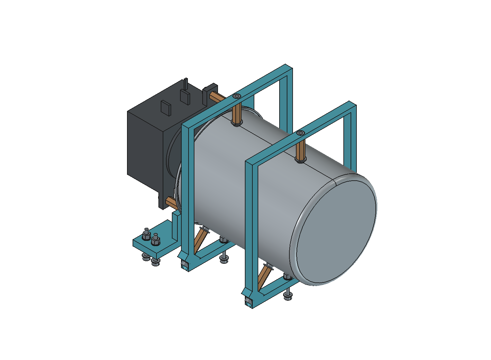

# Heater/cup mounting retrofit — 2026-11-25

**Mechanical fit prototype. No thermal or airflow validation.** The owner has printed every part in `Printed_Assembly` successfully, cannot fabricate metal, and authorized a redesign that preserves those parts. Foil is excluded from the design. No custom partition, band, welded bracket or drilled metal component is required by this retrofit. Ordinary purchased screws/washers/nuts and **eight purchased PEEK spacers** are still required.

Open [MYMS_Mounting_Retrofit.FCStd](../cad/assembly/MYMS_Mounting_Retrofit.FCStd). This is a separate supplemental document; neither [MYMS_Prototype.FCStd](../cad/assembly/MYMS_Prototype.FCStd) nor the owner's original [Hardware_References.FCStd](../cad/assembly/Hardware_References.FCStd) is regenerated or saved. Existing printed shapes are reference snapshots with their original positions and dimensions, not replacement prints or copied feature histories. The four integrated bodies retain native sketch/pad/pocket histories.



## What changes

| Item | Retrofit |
| --- | --- |
| Existing 49 Printed_Assembly bodies | Preserved; no reprinting, new shell holes or metal fabrication specified |
| Heater | Same original position, retained by its two existing tab slots |
| Heater supports | Two single-solid bodies, each integrating base and mast; two 20 mm PEEK spacers connect them to the heater tabs |
| Cup/deflector | Moved **15 mm in +X**: mouth X=95, base X=222; center remains Y=75, Z=65 |
| Cup supports | Two single-solid closed cradles with integral top bridges; three radial PEEK contact assemblies per cradle |
| Metal partition/bands | Omitted from this retrofit; the old mounting studies remain only in the unchanged original assembly |
| Airflow | Free internal return baseline, without a sealed suction/discharge divider; circulation and possible short-circuiting remain unmeasured |
| Foil | Not part of the mounting, shielding or thermal assumptions |

The cup shift gives a **30.5 mm heater-outlet/mouth gap** and **8 mm nominal cup-base/right-wall clearance**. These are geometric distances, not thermal approvals. Both cradle stations, X=113 and 183, remain on the cup barrel. The fixed bridge on the nearer station has limited clearance below the assumed 210 mm spool envelope; do not raise it or substitute taller screw heads without rechecking. No spool, axle, sensor mount, vent, lid or panel is changed.

The independent masts avoid the original partition's combined air-guiding/heater-support role. The rear side of a heater tab is obstructed by details in the owner's model, so mounting from behind was rejected during geometric checking. The front-side arrangement preserves the heater and moves only the purchased cup, which has room to move within the existing shell.

## Parts to print

Select **only `Retrofit_Printed_Parts`** for your usual combined FreeCAD 3MF export. `Existing_Printed_Assembly` and the purchased/reference groups are explanatory geometry. Optional oriented STLs are in [exports/mounting-retrofit](../exports/mounting-retrofit).

| New body | Quantity / orientation |
| --- | --- |
| `PTC_Lower_Support` | 1; continuous outer X=88 face on bed |
| `PTC_Upper_Support` | 1; continuous outer X=88 face on bed |
| `Cup_113_Cradle`, `Cup_183_Cradle` | 1 each; flat wide X face on bed |


Use the owner's ABS for these adapters. First check procurement and measured spacer/screw dimensions, then print one integrated cradle and its matching contact hardware for a **cold fit test** before printing the remaining parts. The tall thin frames, cup clamping and integrated heater support stiffness have not been physically tested. Do not print the brown PEEK references in ABS; PEEK here means bought components, not an assumed capability of the P1S.

The owner requested merging the removable caps and detachable masts into their bases. There are now **four printable bodies instead of eight**, each checked as one solid. The PTC base heels end at X=88, flush with the mast outer face; place that face on the bed so the mast starts on the first layer. Both closed cup frames are planar and print on a broad X face. No socket gaps, mast-clamp screws, cap screws or cap inserts remain. The optional STLs already apply these orientations; obsolete split-part STLs are removed by the generator.

**Assembly tradeoff:** the cup no longer lifts out through removable caps. Bench-assemble the closed frames by sliding them over the cup's **base end**, not its wider mouth lip. Add the top contact assemblies axially as described below. This change does not select a new thermal-interface material: PEEK remains the current geometric placeholder/specification, and the later discussion of porcelain connector bodies has not produced a dimensioned replacement.

## Purchased heat-resistant interface

The reference geometry uses **M3 female/female hex PEEK spacers, 20 mm long, 6 mm across flats**, two for the heater and six for the cup. A documented commercial geometry is Essentra **186302070409 / 10221006**; the manufacturer drawing gives the PEEK material, M3 thread, 20 mm length and 6 mm hex. An alternative commercial listing is Accu **HHTPS-M3-6-20-PK**. These establish a purchasable component family, **not confirmed Brazilian stock, price, delivery or approval for this heater**. Do not order blind: confirm the exact dimensions, thread depth, actual temperature/load rating and availability. No hardware has been purchased by the agent.

**Sourcing limitation, checked 2026-11-25:** [Mouser Brazil's Essentra listing](https://br.mouser.com/en/ProductDetail/Essentra/186302070409?qs=PzGy0jfpSMv/TWwCI5ATWg%3D%3D) reports non-stocked status and a 34-week factory lead time. It is a dimension reference, not a practical immediate purchasing recommendation. [NBK SPE-M3-20-HB](https://www.nbk1560.com/products/specialscrew/nedzicom/outgas/SPE-HB/SPE-M3-HB/SPE-M3-20-HB/) is another manufacturer-defined 20 mm, 6 AF, M3 PEEK spacer with 6 mm minimum threaded lengths and a Japanese in-stock designation; delivery to Brazil and actual landed cost are unverified. All modeled screw engagements are below 6 mm. **Obtain a workable supplier/quote before printing the retrofit parts**; sourcing is still an unresolved part of this design, rather than a promise that these are inexpensive locally available components.

The two screws at opposite ends do not meet inside a spacer. Using the modeled stacks, the nominal metal-tip gaps are 11.5 mm for heater supports, 11.3 mm for lower cup contacts and 10.8 mm for upper cup contacts. These interrupt the continuous metal path found in the earlier ceramic-tube study. PEEK still conducts heat, and radiation/convection bypass it; low conductivity does not establish a safe ABS temperature.

Cup hot ends use stock M3x6 screws with **9 mm OD × 0.8 mm washers** as contact assemblies; modeled screw head diameter is 6 mm and height 2 mm. **Measure the actual head height and spacer length** before using the CAD fit. These dimensions determine the radial stack. The cold ends attach through printed seats; the top cold screws are countersunk to preserve spool clearance. The nominal cup fit is tangent, without a defined clamping-force/preload model.

The physical cup has approximately 6 mm side holes, absent from its CAD. Rotate/position the cup so the pads bear on sound metal lands. A head can enter a perforation before the larger washer catches, changing its center and clamp fit. If adequate seating or retention cannot be achieved, change the contact geometry before using it. **Axial retention currently relies on clamp friction**; no positive axial stop or verified pull/slip force is claimed. Check for rotation, sliding toward the heater and frame flex with the entire cold module assembled. Do not crush the thin perforated cup by overtightening.

## Supplemental fastening list

This list is **additional to** the existing printed-assembly BOM. Dimensions below match the reference envelopes and must be checked against actual purchased hardware. All new M3 clearances are **3.2 mm**. This integrated revision needs **no heat-set inserts**; the earlier four cap insert pockets were removed with the cap joints.

| Purchased item | Quantity | Use |
| --- | ---: | --- |
| PEEK female/female M3 × 20 mm × 6 AF | 8 | 2 heater + 6 cup |
| M3 × 25 screws | 8 | Existing-base connections |
| M3 × 10 screws | 4 | 2 heater hot + 2 heater cold attachments |
| M3 × 12 screws | 4 | Lower cup spacer cold attachments |
| M3 × 8 countersunk screws | 2 | Top cup spacer cold attachments; length includes head |
| M3 × 6 screws | 6 | Cup contact assemblies; modeled 2 mm head height |
| M3 locknuts, nominal 5.5 AF × 4 mm high | 8 | Base connections |
| M3 washers, nominal 7 mm OD × 0.5 mm | 24 | Base 16, heater 4, lower cup cold ends 4 |
| M3 wide washers, 9 mm OD × 0.8 mm | 6 | Cup hot contact assemblies |

There are **24 new screws**, 8 locknuts, 30 washers, no inserts and 8 PEEK spacers. Compared with the split revision, this removes six screws, two nuts, eight washers and four inserts. The drawing shows simplified fastener envelopes rather than manufactured thread geometry. Check actual head dimensions and bolt projection in the physical prints.

## Assembly and fit checks

1. Assemble on an unpowered, cold setup. Keep the original printed base and its existing support holes. Heater base adapters use (X,Y)=(68,21), (78,21), (68,129), (78,129). Cup cradles use (113,61), (113,89), (183,61), (183,89).
2. Fit the two PEEK spacers to the integrated PTC supports and heater tabs. Heater tab reference envelopes are X=57.5..62; the hot washer/screw is behind the tab and PEEK is X=62..82. Use separate short hot/cold screws. There is no mast socket or mast-clamp bolt to assemble. Verify fan inlet, grille and wires are clear.
3. On the bench, assemble each closed cradle's **two lower contact assemblies**, leaving its top PEEK assembly and top cold screw out. Install the downward-facing cold screws before bolting the frame to the floor; access below them is restricted in the box.
4. Slide each closed cradle over the cup's **base end** until it reaches X=113 or 183. Hold the cup approximately **1 mm above the lower contacts** during sliding, then settle it into the lower seats. Do not push the wider mouth lip through the populated cradle. The CAD checks this sampled path against the modeled cup; actual hole edges, dimensions and friction still need a cold fit check.
5. With the cup seated, slide each top PEEK/hot-screw/washer assembly **axially from the +X side** under its fixed bridge, then install its countersunk cold screw from above. The checked path spans 12 mm of axial approach. It is nominally tangent with no defined preload or tolerance allowance; if actual hardware binds, do not force it or bow the bridge—adjust the dimensioned stack before use.
6. Install the assembled module on the existing base before closing the enclosure, or open a panel to provide access; the assembly-path checks above describe bench assembly, not a guaranteed route through installed axle tracks. Cup position stays X=95..222 with perforations open. Check six contact locations, secure grip, thread engagement and cup center. Nominal dimensions are not a torque/preload specification.
7. Install the spool and check rotation, fixed-bridge/screw clearance and cup movement under gentle handling. Servicing the cup now requires unbolting the cradle/module and sliding it apart; it cannot be lifted out by removing a cap. Confirm no hot-side metal touches ABS and no hot/cold screw tips meet.


A successful cold fit does not qualify powered operation. The closest modeled ABS/cup side clearance is only **3.5 mm**, so radiative and convective heating of the cradles needs particular attention. Removing the partition also changes circulation. Actual bracket, PEEK, cup, wall and spool temperatures, fault behavior and the already deferred protection/mounting work remain unresolved. No repeated cutoff-selection approval is requested by this retrofit.

## Reproduce and inspect validation

```bash
bash scripts/build_mounting_retrofit.sh
bash scripts/build_mounting_retrofit.sh scripts/verify_mounting_retrofit.py
```

The first command builds **only the supplemental document**, optional STLs and previews; it does not invoke `build_model.py`. It requires the same FreeCAD AppImage and GUI/display as the existing render workflow. The second reopens/recomputes the native document and checks saved GUI visibility and unchanged source hashes, without saving the source documents.

Source parameters: [cad/mounting_retrofit.json](../cad/mounting_retrofit.json); generator: [build_mounting_retrofit.py](../scripts/build_mounting_retrofit.py). The document spreadsheet is informational. Several mounting profiles and source-layout expectations are fixed to this retrofit; this is not an arbitrary resizable component generator.

[validation.json](../exports/mounting-retrofit/validation.json) records new-part validity/closed meshes, print size and continuous PTC print faces, sampled bench loading/top-contact insertion paths, preservation of existing source files/printed volumes, intersections with all existing printed bodies, heater/cup/spool and stock hardware, base-hole axes and separate screw-tip gaps. Fastener threads intentionally engage purchased spacer material and are represented by nominal envelopes. Geometric checks cannot establish ABS/PEEK temperatures, stiffness, creep, fan flow, cup contact on real perforations, clamp force or drying performance.

Primary component references: [Essentra manufacturer drawing](https://essentracomponents.bynder.com/asset/aa10255d-0003-49b0-ac64-a7c08a4c95ec/10221006_Technical-Drawing-pdf.pdf), [Accu PEEK M3 × 20 × 6 AF listing](https://www.accu.co.uk/threaded-standoffs/464790-HHTPS-M3-6-20-PK).
