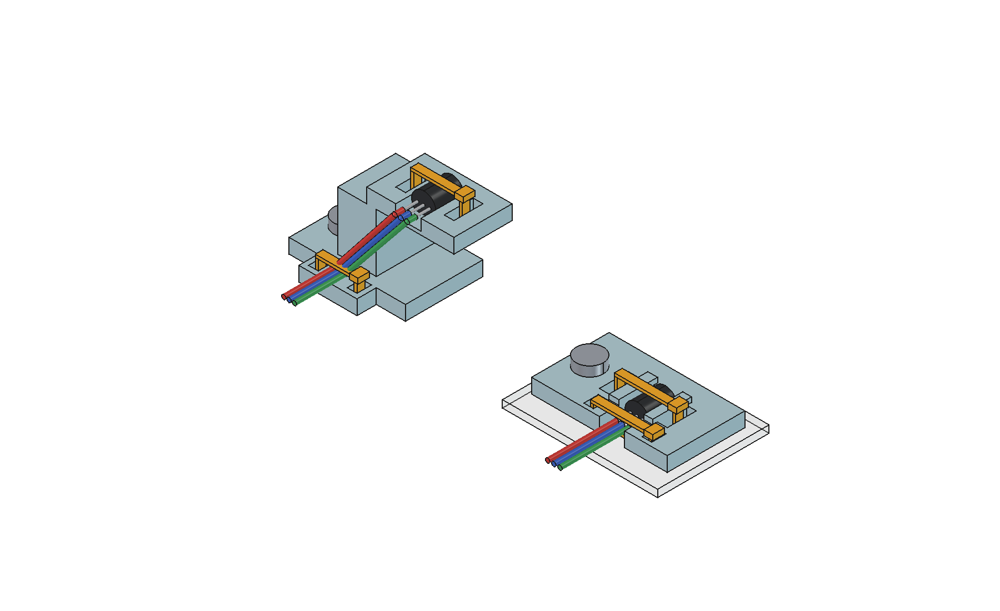
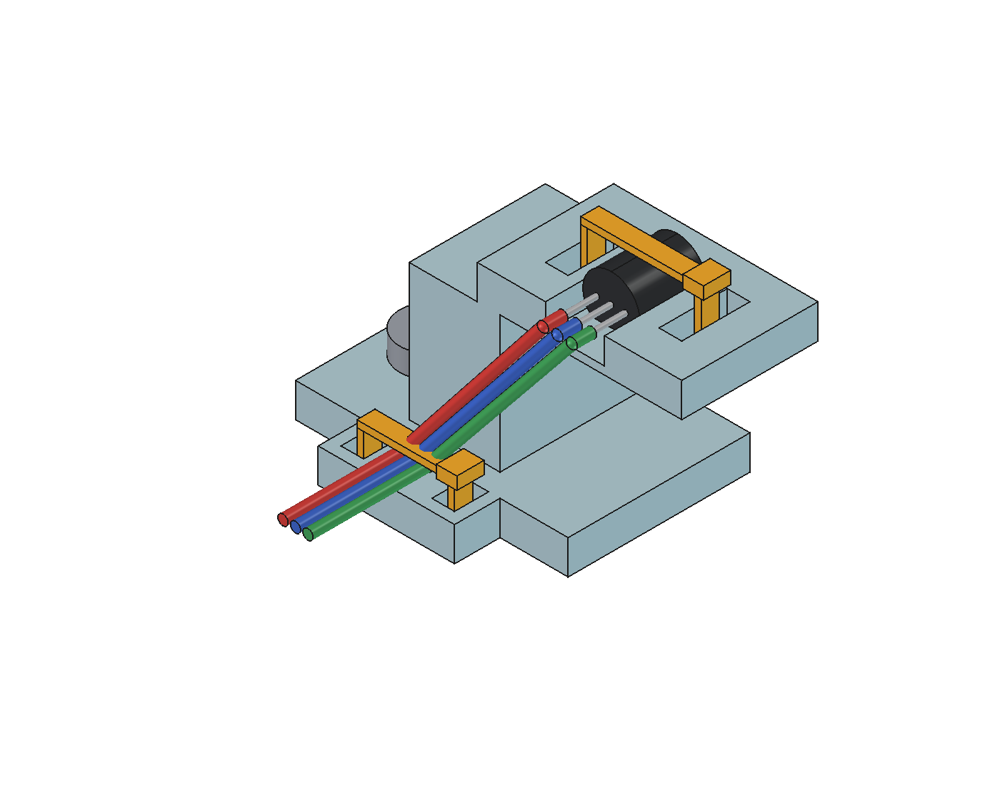
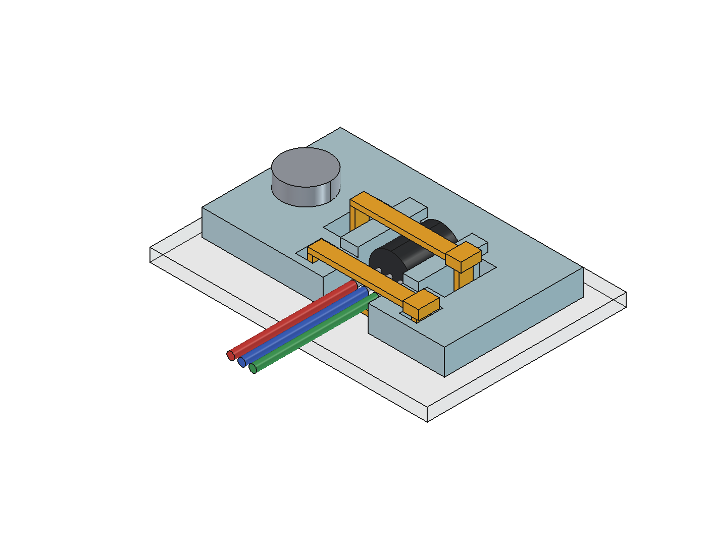

# Sensor mounting and current cable route

See [PROJECT_STATE.md](PROJECT_STATE.md) for the short overall handover. Sensor geometry below is implemented; the direct chamber-to-pod passage described at the end is a proposal, not an implemented or approved routing change.

The separate [sensor demonstration CAD](../cad/assembly/Sensor_Mounts_Demo.FCStd) includes copies of the actual printed mounts, illustrative TO-92-style sensors, retaining ties, mounting screws and insulated leads. These references are not extra parts to print. Sensor envelopes, tie loops and colored leads illustrate mechanical use, not a pinout or a finished soldering instruction.

## Air sensor — Sensor_Mount_1

1. Bolt the base to the wall through its round hole. The support arm holds the sensor away from the wall.
2. Lay the sensor body in the recessed seat, with its leads leaving through the notch in the front of the cradle.
3. Pass a small tie through the two slots beside the sensor, underneath the raised cradle, and back over the sensor body. Tighten gently so the sensor is retained without crushing it. Yellow illustrates the tie.
4. Insulate the three leads/joints individually and bring the cable down toward the projecting base ear. Use the second tie through that ear to grip insulated cable for strain relief. A rear relief lets the tie pass without lifting the mount away from the wall.

## Wall sensor — Sensor_Mount_2

1. Place the sensor body in the central window, with its flat face against the target wall. The raised side locators position it.
2. The leads leave through the open notch below the window. Insulate each lead separately.
3. Run the body-retaining tie through the slots beside the sensor. Its rear path follows the U-shaped groove around the window; it must not cross between the flat sensor face and the wall. The demo's rear wall is transparent to show the contact surface.
4. Use the lower pair of slots and rear relief for a separate wire strain-relief tie.

The sensors are retained by their bodies; do not clamp bare leads or load solder joints. The demonstration checks the modeled sensor envelopes, lead/cable routes and tie routes against the printed mounts. Physical dimensions and tie bend radii still need checking with the actual purchased parts.

This illustration revision adds lead-exit notches and improves the tie relief/ear geometry in the two printed mounts. Their mounting screw positions are unchanged. Main CAD, sensor STLs and previews have been regenerated. Other appliance geometry and cable openings are unchanged.

## Current chamber-to-electronics cable route

| Part | Existing opening | Location in assembly |
| --- | --- | --- |
| Rear_Lower | 14 × 8 mm rectangular opening | X=28–42, Z=38–46, through the 10 mm rear wall |
| Electronics_Lid | Two 18 × 8 mm rectangular slots | X=104–122; one at Z=90–98, one at Z=30–38 |

The chamber opening is to the left of the electronics pod, which spans X=62–174. The pod's wall-facing base has no matching cable opening. Therefore the current route is **out of the chamber, around the outside of the pod, and through a slot in its removable cover**. The CAD does not yet define an enclosed direct passage, a grommet seat, internal cable anchors, or a sealed removable cover for that passage.

Do not route cables through the adjustable air intake or exhaust: it prevents independent adjustment and complicates protection and servicing. Do not rely on a tight raw hole gripping individual wires. The wall crossing needs edge protection and separate mechanical strain relief. Manufacturer examples distinguish [protective grommets](https://www.heyco.com/products/bushings-grommets-heycaps-plugs/tubing-caps-and-plugs/heyco-thick-panel-rubber-grommets/) from [strain-relief bushings](https://www.heyco.com/products/heyware/wire-management/heyco-hinged-edge-strain-relief-bushings/).

Recommended next routing revision: align a dedicated chamber opening with an opening in the pod's wall-facing base, using the 8 mm stand-off space for a short protected passage. Add cable anchors on both sides and an appropriately rated liner, grommet or gland. Measure the insulated heater/fan wire bundle and the largest connector that must pass through before sizing it. Retain a separate sensor cable route/anchor where practical. No manual cutting or final pass-through size is prescribed by this illustration.
